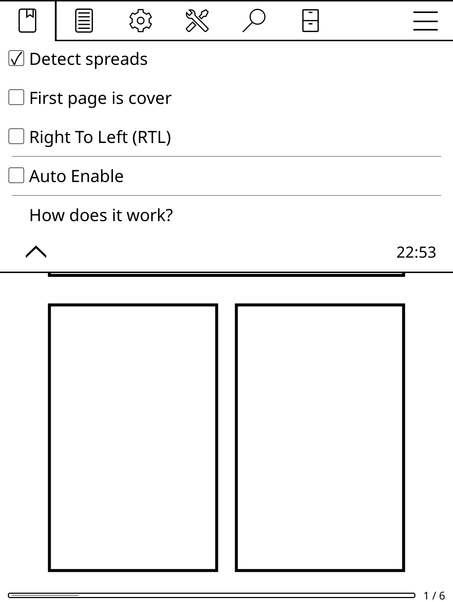
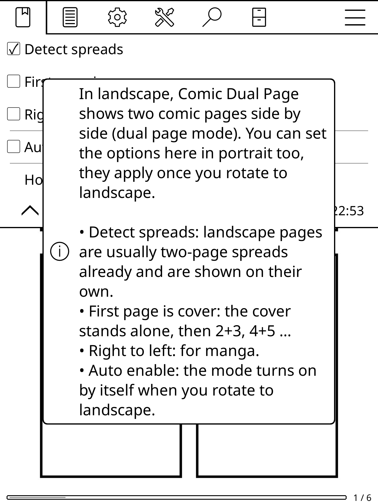

# Comic Dual Page für KOReader

*English: [README.md](README.md)*

<!-- byline -->
Fork von [ComicReader](https://github.com/KORComic/comicreader.koplugin) von [KORComic](https://github.com/KORComic), erweitert von **Akrota und Claude**.

<!-- lang-note -->
*Funktioniert auf **Deutsch und Englisch**: Menüs und Texte richten sich nach der KOReader-Sprache.*

> **Basiert auf [ComicReader](https://github.com/KORComic/comicreader.koplugin) 0.0.7 von [KORComic](https://github.com/KORComic)** (AGPL-3.0).
> Der Doppelseiten-Modus und fast der gesamte Code stammen vom Original. Dies ist eine inoffizielle Fassung, die eine Doppelseiten-Erkennung und ein paar Fehlerbehebungen ergänzt. Alle Credits für das Original-Plugin gehören seinen Autoren. Wenn es dir gefällt, gib bitte auch dem Original einen Stern.
> Die Idee für die Doppelseiten-Erkennung stammt aus [Pull Request #78](https://github.com/KORComic/comicreader.koplugin/pull/78) von hatlessman. Sie wurde für Version 0.0.7 neu umgesetzt.

ComicReader zeigt im Querformat zwei Comic-Seiten nebeneinander. Das Original paart dabei immer 1+2, 3+4 usw., auch wenn eine Seite schon selbst eine Doppelseite ist. Dann landen zwei Querformat-Seiten nebeneinander.

## Neu: Doppelseiten erkennen

Seiten im Querformat (breiter als hoch) gelten als Doppelseite und werden **allein** angezeigt. Die Seiten davor und danach werden passend neu gepaart, damit nichts verrutscht:

- Hochformat + Hochformat = Paar
- Querformat = allein
- Hochformat direkt vor einer Querformat-Seite = allein
- Cover (falls „First page is cover“ an ist) = allein

Beispiel mit Doppelseiten auf Seite 3 und 6: Ansichten 1+2 · 3 · 4+5 · 6 · 7+8.

Das gilt für Blättern, Springen, Lesezeichen und Eselsohr. Steht eine Seite allein, fragt das Lesezeichen nicht mehr „linke oder rechte Seite“.

**Einstellung:** Einen Comic öffnen, dann: oberes Menü → „Dual Page Mode“ → **Doppelseiten erkennen**. Die Einstellungen dort lassen sich auch im Hochformat ändern, schon vor dem Drehen. Standardmäßig an und pro Comic abschaltbar. Ausgeschaltet verhält sich alles genau wie im Original.

**Geschwindigkeit:** Für die Erkennung muss die Größe jeder Seite bekannt sein. Beim ersten Öffnen eines Comics im Doppelseiten-Modus werden die Seiten bis zur aktuellen Seite einmal vermessen, beim Weiterlesen jeweils die nächsten. Das Ergebnis wird im Comic gespeichert, danach gibt es keine Wartezeit mehr.

## Bildschirmfotos

*Die Bildschirmfotos zeigen die englische Oberfläche; in einem deutschen KOReader sind die Texte deutsch.*

<table>
<tr><td align="center" valign="top" width="33%"> Dual-Page-Menü: Doppelseiten erkennen, erste Seite = Cover, rechts nach links, automatisch an</td><td align="center" valign="top" width="33%"> Hilfetext zum Doppelseiten-Modus</td></tr>
</table>

## Installieren

1. Die ZIP-Datei unter [Releases](../../releases) herunterladen und entpacken, oder dieses Projekt herunterladen.
2. Das Original **`comicreader.koplugin` aus dem `plugins`-Ordner löschen**. Beide verändern dieselben Teile von KOReader und dürfen nicht gleichzeitig installiert sein.
3. Den Ordner **`comicdualpage.koplugin`** in KOReaders `plugins`-Ordner kopieren. Auf dem Kobo ist das `.adds/koreader/plugins/`.
4. KOReader neu starten.

Mit ZenOS: Das Original nicht über die ZenOS-Storefront wieder installieren.

## Statistik

Wie beim Original: Ohne das angepasste Statistik-Plugin aus dem Original-Projekt zählt KOReaders Lesestatistik im Doppelseiten-Modus eine Doppelansicht als eine Seite. Alles andere funktioniert unabhängig davon.

## Änderungen gegenüber dem Original (AGPL-Hinweis)

Geändert von Claude (KI von Anthropic) im Oktober 2026:

- Ordner, Plugin-Name und Modulpfad sind umbenannt (`crplus/` statt `src/`), damit es nie mit dem Original kollidiert.
- `crplus/readerpaging.lua`: Die Doppelseiten-Erkennung ist am Dateiende ergänzt (Seitenaufteilung, Blättern, Lesezeichen-Abfrage, Menüpunkt). Die Original-Funktionen bleiben unverändert und werden bei ausgeschalteter Erkennung genutzt.
- Name „Comic Dual Page“ (`comicdualpage.koplugin`) und `_meta.lua` mit zweisprachiger Beschreibung.
- Fehlerbehebungen: Im Doppelseiten-Modus wird beim Blättern immer die letzte Seite erreicht (Original-Issue #76). Bücher mit fließendem Text (EPUB) sind nicht mehr betroffen (#65). Die Einstellungen im Doppelseiten-Menü lassen sich auch im Hochformat ändern. Am Ende des Menüs steht „Wie funktioniert das?“.

Der vollständige Quellcode liegt in diesem Projekt, unter derselben Lizenz wie das Original.

## Getestet auf

Kobo Libra Colour mit KOReader 2026.07.1 und ZenOS.

## Wer das gemacht hat

- **Original-Plugin:** [KORComic](https://github.com/KORComic) und die Mitwirkenden von [comicreader.koplugin](https://github.com/KORComic/comicreader.koplugin).
- **Idee für die Doppelseiten-Erkennung:** hatlessman ([Pull Request #78](https://github.com/KORComic/comicreader.koplugin/pull/78)).
- **Änderungen in dieser Fassung:** vollständig von **Claude** geschrieben, einer KI von Anthropic (in Claude Code). Der Inhaber dieses Projekts hat sich die Funktion gewünscht, auf dem Kobo getestet und Rückmeldungen gegeben, aber keinen Code geschrieben.

Probleme mit dieser Fassung bitte [hier](../../issues) melden, nicht beim Original-Projekt. Es gibt keine Garantie und keinen festen Support.

## Weitere Plugins von Akrota und Claude

- [Comic Display](https://github.com/Akrota/koreader-comic-display): Refresh gegen Ghosting, dunkle Ränder und Uhr für Comics
- [Levels / Tonwerte](https://github.com/Akrota/koreader-comic-levels): Tonwertkurve für Comics
- [Comic Panel Zoom](https://github.com/Akrota/koreader-comic-panel-zoom): Panel-für-Panel-Ansicht (Fork von JorgeTheFox)
- [CBZ Converter](https://github.com/Akrota/koreader-cbz-converter): Comics, PDF und EPUB auf dem Gerät in CBZ umwandeln
- [Folder to series](https://github.com/Akrota/koreader-folder-to-series): Comic-Ordner zu Reihen mit Bandnummern
- [Drive Library](https://github.com/Akrota/koreader-drive-library): Google Drive als Cloud-Bibliothek
- [Story Recall](https://github.com/Akrota/koreader-story-recall): Spoilerfreier KI-Rückblick auf Bücher
- [Guitar Tab Reader](https://github.com/Akrota/koreader-guitar-tab-reader): Gitarren-Tabs und Chords für E-Ink
- [Wi-Fi while charging](https://github.com/Akrota/koreader-wifi-while-charging): WLAN anlassen, solange das Gerät lädt
- [Zen page browser gesture](https://github.com/Akrota/koreader-zen-page-browser-gesture): Geste für den ZenOS-Seitenbrowser

## Lizenz

[GNU AGPL-3.0](LICENSE.md), wie das Original.
