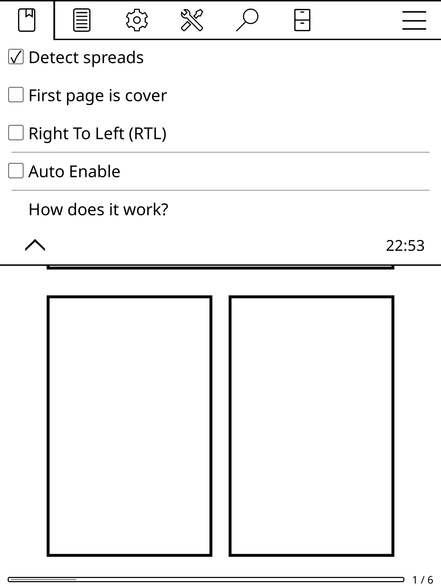
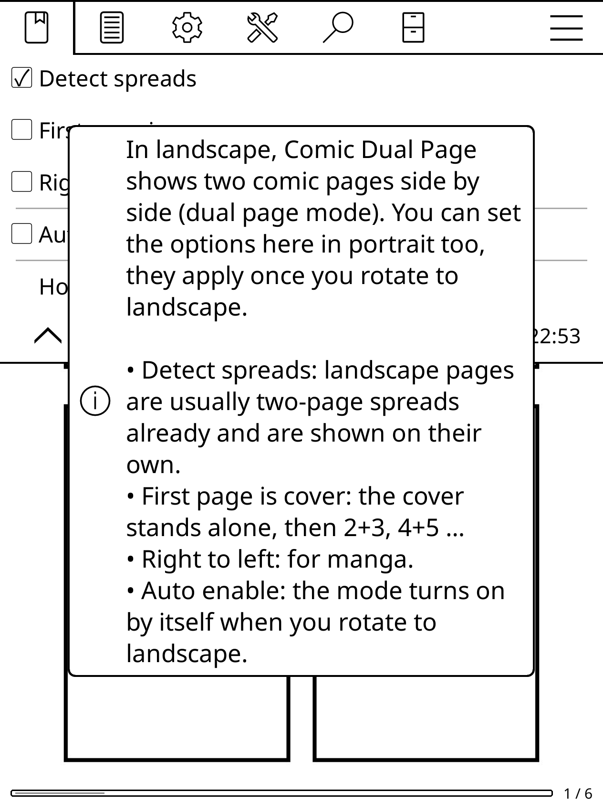

# Comic Dual Page for KOReader

*Deutsch: [README.de.md](README.de.md)*

<!-- lang-note -->
*Works in **English and German**: menus and texts follow KOReader's language. A German description is at the bottom of this page.*

> **Based on [ComicReader](https://github.com/KORComic/comicreader.koplugin) 0.0.7 by [KORComic](https://github.com/KORComic)** (AGPL-3.0).
> The dual page mode and almost all of the code come from the original. This is an unofficial version that adds spread detection and a few fixes. All credit for the original plugin goes to its authors. If you like it, please star the original too.
> The idea for the spread detection comes from [pull request #78](https://github.com/KORComic/comicreader.koplugin/pull/78) by hatlessman. It was implemented anew for version 0.0.7.

ComicReader shows two comic pages side by side in landscape. The original always pairs 1+2, 3+4 and so on, even when a page is already a double-page spread on its own. Then two landscape pages end up next to each other.

## New: spread detection

Pages in landscape format (wider than tall) count as spreads and are shown **on their own**. The pages before and after are re-paired so that nothing shifts:

- Portrait + portrait = pair
- Landscape = on its own
- Portrait directly before a landscape page = on its own
- Cover (if "First page is cover" is on) = on its own

Example with spreads on pages 3 and 6: views 1+2 · 3 · 4+5 · 6 · 7+8.

This applies to page turning, jumping, bookmarks and the dog-ear. When a page stands alone, the bookmark no longer asks "left or right page".

**Setting:** open a comic, then go to: top menu → "Dual Page Mode" → **Detect spreads**. The settings there can also be changed in portrait, before you rotate. It is on by default and can be switched off per comic. When it is off, everything behaves exactly like the original.

**Speed:** For the detection, the size of every page must be known. The first time a comic is opened in dual page mode, the pages up to the current page are measured once, and while you read on, the next ones are measured. The result is saved with the comic, so after that there's no waiting.

## Screenshots

*The screenshots show the English interface; in a German KOReader the texts are German.*

<table>
<tr><td align="center" valign="top" width="33%"> Dual Page menu: detect spreads, first page is cover, right to left, auto enable</td><td align="center" valign="top" width="33%"> Help text for dual page mode</td></tr>
</table>

## Installation

1. Download the ZIP from [Releases](../../releases) and unpack it, or download this repository.
2. **Delete the original `comicreader.koplugin`** from KOReader's `plugins` folder. Both change the same parts of KOReader and must not be installed at the same time.
3. Copy the folder **`comicdualpage.koplugin`** to KOReader's `plugins` folder. On a Kobo, that is `.adds/koreader/plugins/`.
4. Restart KOReader.

ZenOS users: don't reinstall the original from the ZenOS storefront.

## Statistics

As with the original: without the adapted statistics plugin from the original project, KOReader's reading statistics count a dual view as one page in dual page mode. Everything else works independently of that.

## Changes from the original (AGPL notice)

Changed by Claude (AI by Anthropic) in October 2026:

- The folder, plugin name and module path are renamed (`crplus/` instead of `src/`), so it never collides with the original.
- `crplus/readerpaging.lua`: the spread detection is added at the end of the file (page pairing, page turning, the bookmark question and the menu entry). The original functions stay unchanged and are used when the detection is off.
- Name "Comic Dual Page" (`comicdualpage.koplugin`) and `_meta.lua` with a bilingual description.
- Fixes: the last page is always reached when turning pages in dual page mode (original issue #76); books with flowing text (EPUB) are no longer affected (#65); the settings in the dual page menu can also be changed in portrait; a "How does it work?" entry at the end of that menu.

The full source code is in this repository, under the same license as the original.

## Tested on

Kobo Libra Colour with KOReader 2026.07.1 and ZenOS.

## Who made this

- **Original plugin:** [KORComic](https://github.com/KORComic) and the contributors of [comicreader.koplugin](https://github.com/KORComic/comicreader.koplugin).
- **Idea for the spread detection:** hatlessman ([pull request #78](https://github.com/KORComic/comicreader.koplugin/pull/78)).
- **Changes in this version:** written entirely by **Claude**, an AI by Anthropic (in Claude Code). The owner of this repository asked for the feature, tested on a Kobo and gave feedback, but did not write the code.

Please report problems with this version [here](../../issues), not to the original project. There is no warranty and no guaranteed support.

## More plugins

- [Comic Display](https://github.com/Akrota/koreader-comic-display): Refresh against ghosting, dark borders and a clock for comics
- [Levels / Tonwerte](https://github.com/Akrota/koreader-comic-levels): Tone curve for comics
- [Comic Panel Zoom](https://github.com/Akrota/koreader-comic-panel-zoom): Panel-by-panel view (fork of JorgeTheFox's plugin)
- [CBZ Converter](https://github.com/Akrota/koreader-cbz-converter): Convert comics, PDF and EPUB to CBZ on the device
- [Folder to series](https://github.com/Akrota/koreader-folder-to-series): Comic folders to series with volume numbers
- [Drive Library](https://github.com/Akrota/koreader-drive-library): Google Drive as a cloud library
- [Story Recall](https://github.com/Akrota/koreader-story-recall): Spoiler-free AI recap for books
- [Guitar Tab Reader](https://github.com/Akrota/koreader-guitar-tab-reader): Guitar tabs and chords for e-ink
- [Wi-Fi while charging](https://github.com/Akrota/koreader-wifi-while-charging): Keep Wi-Fi on while charging
- [Zen page browser gesture](https://github.com/Akrota/koreader-zen-page-browser-gesture): Gesture for the ZenOS page browser

## License

[GNU AGPL-3.0](LICENSE.md), the same as the original.

---

## Deutsch (Kurzbeschreibung)

> **Basiert auf [ComicReader](https://github.com/KORComic/comicreader.koplugin) 0.0.7 von [KORComic](https://github.com/KORComic)** (AGPL-3.0).
> Der Doppelseiten-Modus und fast der gesamte Code stammen vom Original. Dies ist eine inoffizielle Fassung, die eine Doppelseiten-Erkennung und ein paar Fehlerbehebungen ergänzt. Alle Credits für das Original-Plugin gehören seinen Autoren. Wenn es dir gefällt, gib bitte auch dem Original einen Stern.
> Die Idee für die Doppelseiten-Erkennung stammt aus [Pull Request #78](https://github.com/KORComic/comicreader.koplugin/pull/78) von hatlessman. Sie wurde für Version 0.0.7 neu umgesetzt.

ComicReader zeigt im Querformat zwei Comic-Seiten nebeneinander. Das Original paart dabei immer 1+2, 3+4 usw., auch wenn eine Seite schon selbst eine Doppelseite ist. Dann landen zwei Querformat-Seiten nebeneinander.

### Neu: Doppelseiten erkennen

Seiten im Querformat (breiter als hoch) gelten als Doppelseite und werden **allein** angezeigt. Die Seiten davor und danach werden passend neu gepaart, damit nichts verrutscht:

- Hochformat + Hochformat = Paar
- Querformat = allein
- Hochformat direkt vor einer Querformat-Seite = allein
- Cover (falls „First page is cover“ an ist) = allein

Beispiel mit Doppelseiten auf Seite 3 und 6: Ansichten 1+2 · 3 · 4+5 · 6 · 7+8.

Das gilt für Blättern, Springen, Lesezeichen und Eselsohr. Steht eine Seite allein, fragt das Lesezeichen nicht mehr „linke oder rechte Seite“.

**Einstellung:** Einen Comic öffnen, dann: oberes Menü → „Dual Page Mode“ → **Doppelseiten erkennen**. Die Einstellungen dort lassen sich auch im Hochformat ändern, schon vor dem Drehen. Standardmäßig an und pro Comic abschaltbar. Ausgeschaltet verhält sich alles genau wie im Original.

**Geschwindigkeit:** Für die Erkennung muss die Größe jeder Seite bekannt sein. Beim ersten Öffnen eines Comics im Doppelseiten-Modus werden die Seiten bis zur aktuellen Seite einmal vermessen, beim Weiterlesen jeweils die nächsten. Das Ergebnis wird im Comic gespeichert, danach gibt es keine Wartezeit mehr.

Die ausführliche deutsche Anleitung steht in der [README.de.md](README.de.md).
